  <a href="https://codeportala.com">codeportala.com</a> ·
  <a href="https://x.com/whoisadityaj">X @whoisadityaj</a> ·
  <a href="https://www.linkedin.com/in/whoisadityaj/">LinkedIn</a> ·
  <a href="https://www.instagram.com/whoisadityaj/">Instagram</a> ·
  <a href="mailto:letsmailadityaj@gmail.com">Email</a>

### What I've built

  
  
  

> **Why CodePortala?** Portala was my first startup, the one that lit a fire in me to build something of my own. CodePortala is where I keep building from there.
