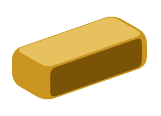
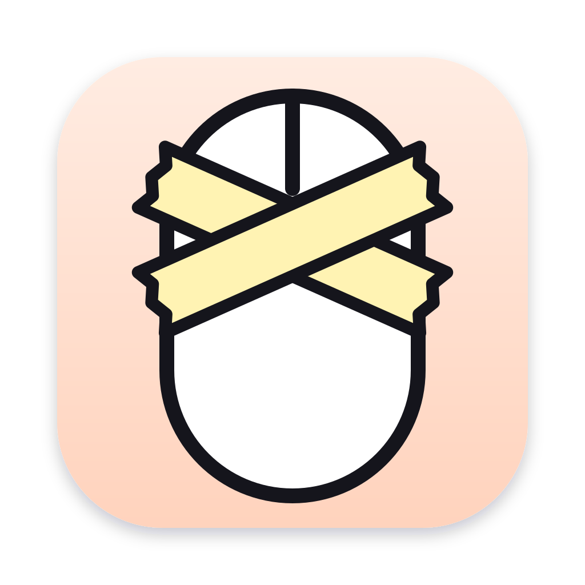

# Hey, I'm Aditya 👋

**Building Internet Startups. built 2 Startups.**

Fired a couple of times. Failed a couple of times. Still here. Still building.

[CodePortala](https://codeportala.com) · [X @whoisadityaj](https://x.com/whoisadityaj) · [LinkedIn](https://www.linkedin.com/in/iadityajain/)

## What I've built

| | Startup | |
|---|---|---|
|  | [**Ultimate Gold Tracker**](https://ultimategoldtracker.com/) | Gold moves. Know why. |
|  | [**HushMouse**](https://hushmouse.com/) | A tiny, private macOS menu-bar app that shows the shortcut you could have pressed instead of clicking. |

## Why CodePortala?

Portala was my first startup, the one that lit a fire in me to build something of my own.
CodePortala is where I keep building from there.

## Follow along

Startup updates and honest lessons, only when there's something worth sharing →
[@whoisadityaj on X](https://x.com/whoisadityaj)
